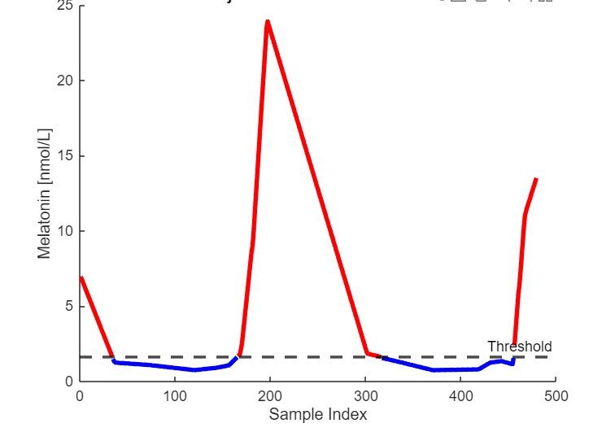
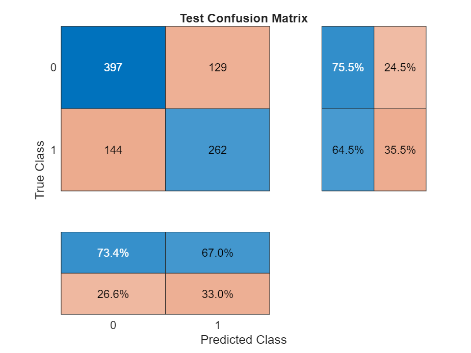
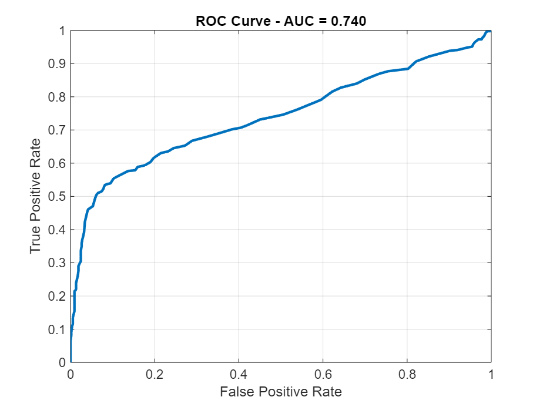

# Non-Invasive Circadian Phase Assessment from Wearable HRV

Detecting circadian phase transitions from heart rate variability (HRV) alone, using salivary melatonin and cortisol as reference.

Bachelor's project (Biomedical Engineering, Università Campus Bio-Medico di Roma), by Elisa Consoni. The full write-up is in [`docs/circadian_phase_report.pdf`](docs/circadian_phase_report.pdf).

## Overview

Circadian phase is normally assessed by repeated salivary or blood sampling of melatonin and cortisol, which is invasive and impractical outside the laboratory. HRV reflects autonomic activity, which is itself modulated by the circadian system, and can be derived from wearable ECG. The aim of the project is to build a software tool that **recognises the circadian phase from HRV features only**, so that hormone sampling is needed only to train and validate it.

**Data** (not included): 10 healthy volunteers wore a chest ECG device for two or more consecutive days. The ECG was cut into non-overlapping 5-minute windows and, for each window, 51 HRV features were computed (time-domain, frequency-domain with Welch and autoregressive spectra, and non-linear measures such as Poincaré descriptors, entropies and recurrence analysis). Salivary cortisol and melatonin were sampled every 2-4 hours over the same days and linearly interpolated to the midpoint of each window, so that every window carries a hormone value.

```
wearable ECG ──► 5-min HRV features ─┐
                                      ├─► merged table (features + interpolated hormones)
salivary cortisol / melatonin ───────┘                │
                                                      ▼
                          HRV feature selection  ·  hormone-based labels  ·  classifier
```

## What this repository contains

| Script | Step |
|---|---|
| [`matlab/HRV_feature_selection.m`](matlab/HRV_feature_selection.m) | Reduces the 51 HRV features to a compact, non-redundant set |
| [`matlab/Melatonin_onset.m`](matlab/Melatonin_onset.m) | Labels each window as low or high melatonin with a subject-specific threshold |
| [`matlab/melatonin_model.m`](matlab/melatonin_model.m) | Trains a bagged tree ensemble on 8 subjects and tests it on 2 unseen subjects |

The interpolation and merging of the hormone series, the melatonin-onset detection with the 3k method, the cortisol peak/trough labelling and the export of the feature matrices described in the report are **not part of this repository**.

## Method

**Feature selection.** All HRV features are ranked by their mean absolute Spearman correlation with the others; features are clustered (hierarchical clustering on 1 - |ρ|) and displayed as a heatmap, and groups of highly correlated features (|ρ| > 0.7) are formed. Within each group, features are kept according to their correlation with cortisol and melatonin and to the literature, consistently with earlier HRV studies by Castaldo and colleagues. Approximate and sample entropy were added from the literature. The final set has 19 features: mean, standard deviation, minimum and maximum heart rate; RMSSD; pNNxx; HRV triangular index; TINN; Welch LF power, HF power, LF/HF and log total power; AR LF, HF and total power; Poincaré SD2; SD2/SD1; approximate and sample entropy.

**Labels.** For each subject the melatonin profile is split into tertiles; the threshold is the mean of the values in the middle tertile, and each window is labelled 1 when the interpolated melatonin is at or above the threshold and 0 otherwise.

<p align="center">
  
</p>

**Model.** Features are z-scored with the statistics of the training subjects. A bagged ensemble of classification trees is trained on 8 subjects and evaluated on the 2 held-out subjects (2 and 3), so that no window of a test subject is seen during training.

## Results

On the 932 windows of the two test subjects (526 low-melatonin, 406 high-melatonin):

| Accuracy | Sensitivity | Specificity | Precision | F1 | AUC |
|---|---|---|---|---|---|
| 70.7% | 64.5% | 75.5% | 67.0% | 65.8% | 0.74 |

<p align="center">
  
  
</p>

HRV features therefore carry information about the melatonin state of a person the model has never seen, but the classification is far from accurate enough for use as a circadian-phase marker.

## Limitations

- **Two test subjects.** The estimate comes from a single subject-wise split with two volunteers; a leave-one-subject-out evaluation would be more reliable. Windows of the same subject are strongly autocorrelated, so the 932 windows are not independent observations.
- **Feature selection is not independent of the test data.** The correlations used to choose the features were computed on subject 2, who is also one of the two test subjects.
- **Metrics to be re-checked.** The values above are those stored with the original script. In this repository the model script also excludes the cortisol and threshold columns from the inputs and prints the number of features used; please rerun it to confirm the numbers.
- **Labels are a proxy.** The "high melatonin" state defined by a tertile threshold is not a dim-light melatonin onset, and hormone values between samples (2-4 hours apart) are linear interpolations.
- **Small, healthy cohort,** with no external validation.

## Running the scripts

The HRV and hormone data of the volunteers are **not included**. The scripts need MATLAB with the Statistics and Machine Learning Toolbox and expect one CSV per subject in the working folder:

1. `HRV_feature_selection.m` reads `subject_2_melatonin_all.csv` (HRV features plus `Date`, `Start`, `End`, `MidTime`, `Cortisol`, `Melatonin`); change `subject_id` to analyse another subject.
2. `Melatonin_onset.m` asks for a subject file and writes `<name>_with_onset_threshold.csv`; run it for each of the 10 subjects, naming the input files so that the outputs are `subject_<n>_melatonin_with_onset_threshold.csv`, as read by the next script.
3. `melatonin_model.m` reads `subject_1..10_melatonin_with_onset_threshold.csv` and reports the test metrics.

## License

Code released under the [MIT License](LICENSE). No volunteer data are included.
